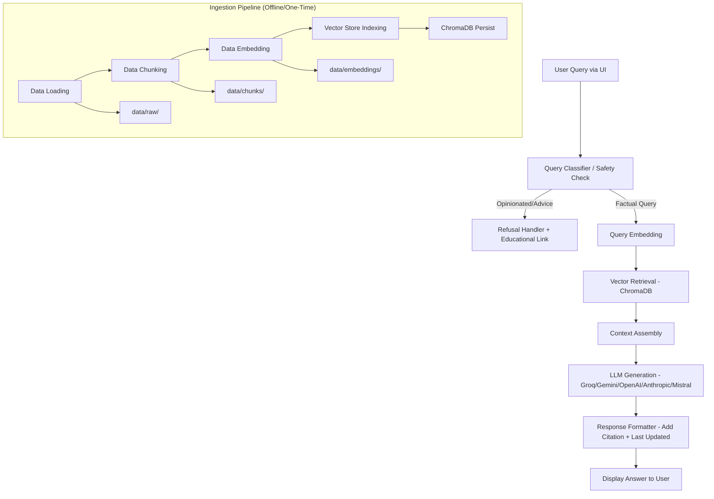

# Architecture Document

# Groww Mutual Fund FAQ RAG Assistant - Architecture

## 1. Overview

This document outlines the technical architecture for the Groww Mutual Fund FAQ Assistant. The system is a Retrieval-Augmented Generation (RAG) pipeline designed to answer factual questions about HDFC Mutual Fund schemes using only official public Groww pages. The architecture emphasizes explicit data persistence at each stage for demonstration purposes, strict facts-only responses, and configurability. 

---

## 2. Goals & Design Principles

- **Facts-Only**: Answers must only be derived from retrieved context. No investment advice or performance claims.
- **Transparency**: Every stage (Loading, Chunking, Embedding, Indexing, Retrieval, Generation) must persist artifacts explicitly.
- **Citations First**: Every answer must include exactly one source link.
- **Config-Driven**: Models, chunking strategy, vector DB, and providers must be configurable via a central config file.
- **Safe by Default**: Refuse opinionated/portfolio queries with polite messaging and educational links. No PII handling.
- **Small Corpus**: Optimized for 5 sources (HDFC AMC + 4 schemes) to demonstrate RAG concepts clearly.

---

## 3. System Architecture

### 3.1 High-Level Architecture



---

## 4. Component Design

### 4.1 Data Sources
| Source | URL | Purpose |
|---------|-----|---------|
| HDFC AMC Overview | https://groww.in/mutual-funds/amc/hdfc-mutual-funds | AMC-level facts (general info) |
| HDFC Large Cap Fund Direct Growth | https://groww.in/mutual-funds/hdfc-large-cap-fund-direct-growth | Scheme facts |
| HDFC Flexi Cap Direct Plan Growth | https://groww.in/mutual-funds/hdfc-equity-fund-direct-growth | Scheme facts |
| HDFC ELSS Tax Saver Fund Direct Plan Growth | https://groww.in/mutual-funds/hdfc-elss-tax-saver-fund-direct-plan-growth | ELSS-specific facts (lock-in) |
| HDFC Mid Cap Fund Direct Growth | https://groww.in/mutual-funds/hdfc-mid-cap-fund-direct-growth | Scheme facts |

### 4.2 Ingestion Pipeline

| Phase | Component | Details | Artifacts Stored |
|-------|-----------|---------|-------------------|
| **1. Data Loading** | Web Scraper | Scrape only public Groww pages. Extract clean text (remove nav/ads/scripts). Preserve source URL. | `data/raw/{source_id}.html` / `data/raw/{source_id}.txt` with metadata JSON |
| **2. Data Chunking** | Chunking Engine | Strategy selected based on data structure (section-based/recursive/semantic). Chunk size/overlap configurable. Preserve metadata (source_url, source_name, section, chunk_id). | `data/chunks/chunks.json` (list of chunks with metadata) |
| **3. Data Embedding** | Embedding Generator | Use `sentence-transformers/all-MiniLM-L6-v2`. Generate embeddings for each chunk. | `data/embeddings/embeddings.json` or paired with chunks (with embedding vectors) |
| **4. Vector DB Indexing** | ChromaDB Client | Create collection, upsert documents, embeddings, and metadata. Persist to disk. | ChromaDB persistent directory (e.g., `./chroma/` or config path) |

### 4.3 Query Pipeline (Inference)

| Step | Component | Details |
|------|-----------|---------|
| **1. Input** | UI | Tiny UI with welcome line, 3 example questions, "Facts-only. No investment advice." disclaimer. No PII fields. |
| **2. Safety Classifier** | Query Filter | Detect opinionated/portfolio queries (e.g., "should I buy/sell", "which is better for me"). On match → polite refusal with facts-only message + relevant educational link. |
| **3. Query Embedding** | Embedding Model | Embed query using same model as ingestion: `sentence-transformers/all-MiniLM-L6-v2`. |
| **4. Retrieval** | ChromaDB Retriever | Similarity search (configurable top-k, e.g., 3-5). Filter by metadata if needed. Return chunks with source_url. |
| **5. Context Assembly** | Context Builder | Assemble retrieved chunks into concise context. Enforce facts-only grounding. |
| **6. Generation** | LLM Client | Call configured provider (Groq default) with `qwen/qwen3.8-27b`. System prompt enforces: facts-only, ≤3 sentences, include exactly one source link, add "Last updated from sources: ", refuse if not in context, no advice/performance claims. |
| **7. Response Formatting** | Post-Processor | Ensure exactly one citation link, append "Last updated from sources: <date>", enforce length constraint, validate no advice leaked. |
| **8. Output** | UI | Display formatted answer with citation. |

---

## 5. Configuration

All changeable components must live in a central config file (e.g., `config.yaml` or `config.py`). Secrets in `.env`.

### 5.1 Config Structure

```yaml
# config.yaml
data_loading:
  sources:
    - id: hdfc_amc
      name: "HDFC Mutual Fund AMC Overview"
      url: "https://groww.in/mutual-funds/amc/hdfc-mutual-funds"
    - id: hdfc_large_cap
      name: "HDFC Large Cap Fund Direct Growth"
      url: "https://groww.in/mutual-funds/hdfc-large-cap-fund-direct-growth"
    # ... (4 more)
  raw_dir: "./data/raw"
  metadata_file: "./data/raw/metadata.json"

chunking:
  strategy: "section_based"  # or recursive, semantic; agent decides based on data
  chunk_size: 500
  chunk_overlap: 50
  chunks_dir: "./data/chunks"

embedding:
  model_name: "sentence-transformers/all-MiniLM-L6-v2"
  embeddings_dir: "./data/embeddings"

vector_db:
  type: "chromadb"
  persist_directory: "./chroma"
  collection_name: "hdfc_mf_faq"
  distance_metric: "cosine"

retrieval:
  top_k: 4
  similarity_threshold: 0.3

llm:
  default_provider: "groq"
  providers:
    groq:
      model: "qwen/qwen3.8-27b"
      api_key_env: "GROQ_API_KEY"
      base_url: optional
    gemini:
      model: "gemini-pro"
      api_key_env: "GEMINI_API_KEY"
    openai:
      model: "gpt-4o-mini"
      api_key_env: "OPENAI_APIC_KEY"
    anthropic:
      model: "claude-3-haiku-initkey/anthropic:claude-3.5-haiku"
      api Key_env: "ANTHROPIC_API_KEY"
    mistral:
      model: "mistral-small-latest"
      api_key_env: "MISTAL_API_KEY"
```

### 5.2 Environment Variables (.env)

```env
# Primary
GROQ_API_KEY=your_groq_key
LLM_MODEL=qwen/qwen3.8-27b
LLM_PROVIDER=groq

# Optional providers
GEMINI_API_KEY=
OPENAI_API_KEY=
ANTHROPIC_API_KEY=
MISTRAL_API_KEY=
```

---

## 6. Data Flow

1. **Ingestion (Offline)**: Load config → scrape sources → store raw → chunk → store chunks → embed with all-MiniLM-L6-v2 → store embeddings/index to ChromaDB.
2. **Query (Online)**: User query → safety check → embed query → retrieve top-k from ChromaDB → assemble context → generate with LLM (Groq/qwen) → format with citation + timestamp → return to UI.
3. **Demonstration**: Each step produces explicit artifacts (raw, chunks, embeddings, index) that can be inspected to show RAG stages.

---

## 7. Security & Constraints

| Constraint | Implementation |
|------------|----------------|
| Public sources only | Only scrape specified Groww URLs. No third-party blogs. |
| No PUI I/PII | UI has no PII fields; no logging of sensitive data. Filter inputs for PII patterns if desired. |
| No advice | System prompt forbids advice/recommendations; refusal handler for buy/sell/portfolio questions. |
| No performance claims | Prompt forbids calculations/comparisons; instruct to link to factsheet if asked. |
| One citation per answer | Post-processing ensures exactly one source link. |
| ≤3 sentences | Prompt and post-processing enforce. |
| Facts-only grounding | Use retrieved context only; refuse if insufficient context. |

---

## 8. Project Structure

```text
groww-mf-faq-rag/
├── config/
│   ├── config.yaml
│   └__config.py
├── data/
│   ├── raw/        # Scraped raw content
│   �;├── chunks/    # Chunked JSON with metadata
│   └── embeddings/ # Embedding artifacts (demo)
├── chroma/         # ChromaDB persistent storage
├── src/
│   ├── data_loader.py      # Phase 1: Loading
│   ├── chunker.py          # Phase 2: Chunking
# PR TITLE: Create Architecture Document for Groww MF FAQ RAG Assistant

# PR DESCRIPTION:
Issue to resolve: Create architecture.md using PRD.md

## Summary
Created the architecture document `architecture.md` based on the PRD. It outlines the RAG pipeline (data loading, chunking, embedding, vector DB, retrieval, LLM generation), configuration (config file + .env), data flow, security/constraints, project structure, UI design, and testing strategy.

## Changes
- Added `architecture.md` in the repo root with high-level architecture diagram (mermaid), component details, config structure, environment variables, data artifacts, security constraints, project structure, UI requirements, and acceptance criteria alignment.

## Notes
- Embedding model: `sentence-transformers/all-MiniLM-L6-v2` (ingestion & retrieval)
- Vector DB: ChromaDB
- Primary LLM: Groq with `qwen/qwen3.8-27b` from `.env`, with support for Gemini, OpenAI, Anthropic, Mistral
# PR TITLE: Create PRD for Groww MF FAQ RAG Assistant
## Summary
Created the PRD based on Problem statement.txt. It defines objectives, scope (5 HDFC/Groww pages), facts-only behavior, phase-wise RAG pipeline requirements, config/ .env expectations, deliverables, skills tested, and acceptance criteria.

## Changes
- Added `PRD.md` in root
# PR TITLE: Create Problem Statement File
## Summary
Created `Problem statement.txt` containing the build requirements for the Groww MF FAQ assistant (facts-only, citations, RAG demo with explicit stage artifacts, phase-wise implementation, models/DB/LLM specs).

## Changes
- Added `Problem statement.txt` in root
# PR BODY:
PR for creating architecture.md using PRD.md. Implements detailed architecture for RAG pipeline with explicit artifacts, config-driven setup, facts-only constraints, and multi-provider LLM support.
```

### 9.1 UI Requirements
- Welcome line
- 3 example questions (e.g., "What is the expense ratio of HDFC Large Cap Fund Direct Growth?", "What is the ELSS lock-in period?", "What is the minimum SIP for HDFC Mid Cap Fund Direct Growth?")
- Note: "Facts-only. No investment advice."
- Answer area with citation link
- Disclaimer snippet

### 9.2 Testing Strategy
| Test Type | Focus |
|-----------|---------| 
| Unit | Chunking, embedding, retrieval, safety classifier, formatting
| Integration | End-to-end pipeline, config loading, multi-provider LLM
| Manual/Functional | Facts-only, refusal cases, citation presence, ≤3 sentences, timestamp
| Demo | Inspect artifacts at each stage (raw/chunks/embeddings/chroma) 

---

## 10. Acceptance Criteria Alignment
From PRD, architecture supports all acceptance criteria:
- 5 sources scraped/stored explicitly via data_loader
- Phase-wise with explicit artifacts
- all-MiniLM-L6-v2 for ingestion & retrieval
- ChromaDB config-driven
- Config file + .env structure
- Groq + qwen/qwen3.8-27b + multi-provider support
- One citation, refusal, ≤3 sentences, timestamp
- UI requirements, deliverables ready
